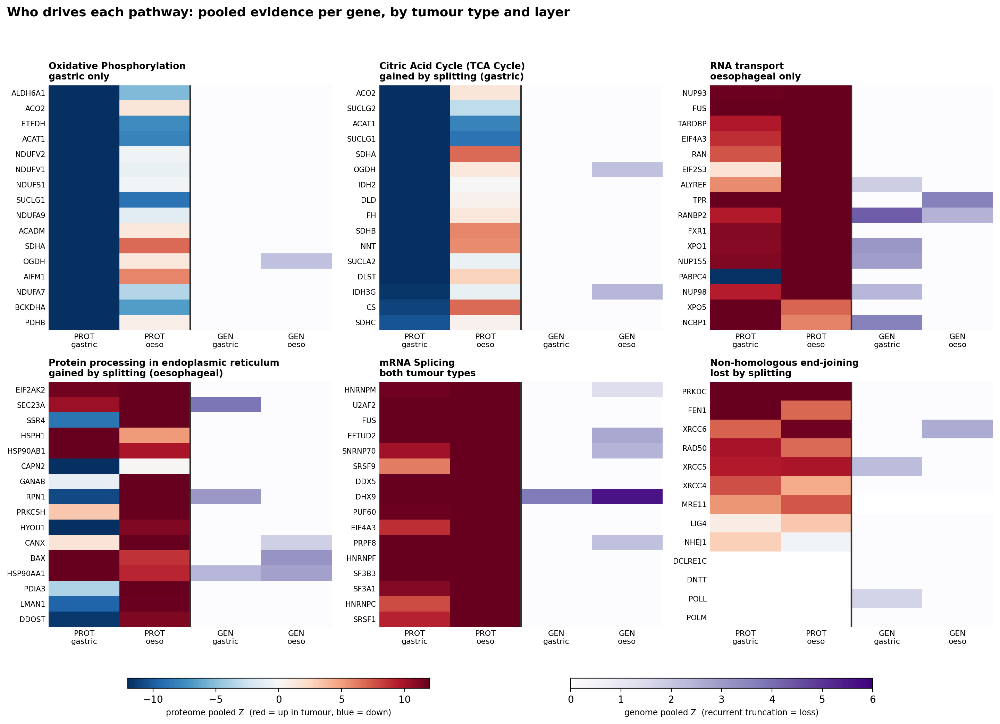
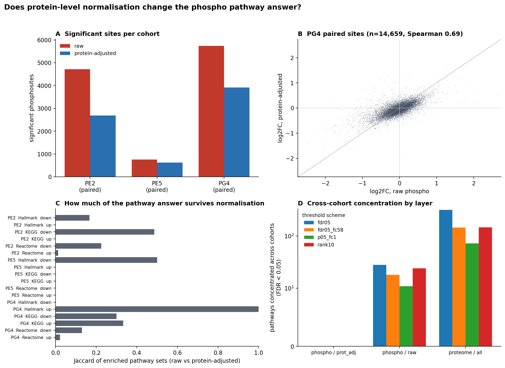
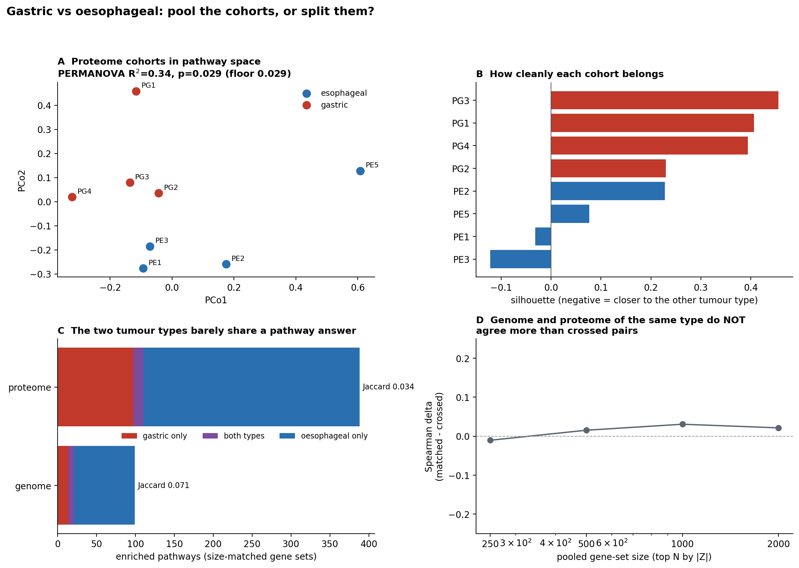

# Multi-omic pathway meta-analysis

`03_integration/multiomics` of
[Multiomics_meta_analysis](https://github.com/Hyunmisong/Multiomics_meta_analysis).
Joint analysis across layers; the per-layer pipelines live in `01_proteomics`
and `02_phosphoproteomics`.

8 proteome cohorts, 3 phosphoproteome cohorts in two normalisations, 5 genome
cohorts, with single-cell RNA-seq to follow.

The sub-project is organised around how the analysis actually moved, because
that is the part worth reusing:

> **gene -> pathway -> back to gene.**
> The gene level ran out of interpretable signal. The pathway level gave an
> answer. The pathway level's own summary number was then *not* taken as the
> answer - going back down into the member genes is where the mechanism was.

Everything below is association across cohorts of different patients. No causal
claim is made anywhere.

---

## What this concludes

1. **How the phosphoproteome is quantified changes the pathway result.**
   Normalising phosphosites to their parent protein removes 18-43% of the
   significant sites, and the enriched pathway sets barely overlap (median
   Jaccard 0.00-0.28 under any cutoff).
2. **Cutoffs are chosen by evidence, not taste.** Nine threshold schemes are
   run on every cohort and compared on how well their pathway calls reproduce
   across independent cohorts. The comparison is regenerated on every run:
   [docs/scheme_comparison.md](docs/scheme_comparison.md).
5. **Each layer also has its own report** of what its cohorts agree on:
   [proteome](docs/layer_proteome.md) | [phospho](docs/layer_phospho.md) |
   [genome](docs/layer_genome.md) | [scRNA-seq](docs/layer_scrna.md).
3. **Gastric and oesophageal cohorts should be analysed apart.** Tumour type
   explains 34% of the variation between proteome cohorts, and the two types'
   pathway answers share a Jaccard of 0.034.
4. **That last conclusion does not rest on the 0.034.** Going back into the
   member genes shows *why*: the same pathway contains genes moving in opposite
   directions in the two tumour types, so pooling does not merely dilute the
   signal, it cancels it.

---

## The reasoning spine: gene -> pathway -> gene

### 1. The gene level ran out of signal

The first pass was a consensus gene list across the 8 proteome cohorts, using
the DEP rule the source studies used (raw p < 0.05 and |log2FC| > 1):

| cohorts agreeing | genes |
|---|---|
| 7 of 8 | **1** (EPCAM) |
| 6 or more | 10 |
| 5 or more | 45 |

One gene is not a result. Loosening to FDR < 0.05 raises the 8-of-8 list to 70
genes, but **21 of those 70 disagree on direction between cohorts** - the
consensus list is 30% self-contradictory even at its core.

The obstacle is not that cohorts disagree pairwise. Pairwise they agree
reasonably well: mean Jaccard of called genes **0.418** over the 28 cohort
pairs. It is that any two cohorts share only about half a universe (mean common
universe 4,604 of ~9,000 measured genes), each pair overlaps on a *different*
half, and requiring all eight at once collapses the list to nothing.

So the analysis moved up a level - not because genes were unreproducible, but
because the shared gene list was too small to interpret.

### 2. The pathway level gave an answer

Enrichment is computed per cohort against that cohort's own measured
background, then the question becomes how many independent cohorts implicate
the same pathway. That works:

| Hallmark pathway | cohorts enriched | null expectation |
|---|---|---|
| E2F Targets | **8 / 8** | 1.22 |
| Myc Targets V1 | 7 / 8 | 1.22 |
| G2-M Checkpoint | 7 / 8 | 1.22 |
| Oxidative Phosphorylation, Myc Targets V2, Fatty Acid Metabolism, Xenobiotic Metabolism, DNA Repair | 5 / 8 each | 1.22 |

Proliferation up, metabolism down - what gastro-oesophageal tumour proteomes
are expected to show, now with 8 independent cohorts behind it. Pathways
recovered what genes could not: they pool weak per-gene evidence and survive
the fact that cohorts measure different genes.

### 3. The pathway summary number was not the answer

Splitting the cohorts by tumour type gives a Jaccard of **0.034** between the
gastric and oesophageal pathway sets. Read alone, that number says "split them"
and the analysis could have stopped there.

It did not, because 0.034 is compatible with two very different situations: the
two types could be reporting *different* biology, or they could be reporting
the *same* biology at different power. Only the member genes distinguish those.

Going back down:



*Rows are member genes; columns are the pooled evidence in each tumour type and
each layer. Proteome columns are signed (red up, blue down); genome columns are
not, because a truncation has only one direction.*

- **Oxidative Phosphorylation** - in gastric, the respiratory-chain and TCA
  enzymes (NDUFV1/2, NDUFS1, NDUFA7/9, SUCLG1, ACAT1, PDHB) are uniformly
  **down**. In oesophageal the same pathway's SDHA, SDHB and CS are **up**.
- **Protein processing in the ER** - oesophageal is uniformly up; gastric
  splits, with HYOU1, DDOST, LMAN1, CAPN2 down and HSPH1, HSP90AB1, BAX up.

The two tumour types are not weak versions of each other. Within one pathway
they contain genes moving in opposite directions, and pooling makes those
cancel. **Pooling here does not cost power, it destroys signal** - a different
reason to split, and a much stronger one than a low Jaccard.

In hindsight the warning was already in step 1: 21 of the 70 consensus genes
had conflicting directions. The gene level had the answer but not enough genes
to see it; the pathway level had enough genes but hid the direction; only the
two together showed it.

---

## The data

| layer | cohorts | note |
|---|---|---|
| proteome | PG1-PG4, PE1, PE2, PE3, PE5 | 8 cohorts, 1,714-11,340 proteins |
| phospho (raw) | PE2, PE5, PG4 | 4,211-15,950 sites tested |
| phospho (protein-adjusted) | PE2, PE5, PG4 | same rows, same table |
| genome | GG1, GG2, GE1, GE2, GE3 | 5 cohorts, 19,258-gene universe |
| scRNA-seq | SG1, SE1, SG2, SM1, SG3, SG4, SG5 | 7 studies, pseudobulk DESeq2 per cell lineage |

Every cohort carries a `tissue` tag: proteome and phospho PG* are gastric and
PE* oesophageal; genomics splits 2 gastric / 3 oesophageal.

### One uncut master input

`scripts/00_build_master.py` reads the scattered source files described in
`config/sources.yaml` and writes three harmonised tables:

```
data/master/GEC_master_proteome.csv   56,511 rows
data/master/GEC_master_phospho.csv    31,163 rows, both arms on the same row
data/master/GEC_master_genome.csv     96,290 rows
data/master/MANIFEST.md               provenance, row counts, source checksums
```

**No significance filter is applied at build time.** Linear ratios are
log2-transformed, BH FDR is computed where a source ships none, gene symbols
are resolved, and phospho `raw_tested` / `adj_tested` flags record which arm
produced a statistic. Every threshold decision happens downstream in
`config/analysis.yaml`, so changing a cutoff never means rebuilding the input.

Two source decisions worth knowing:

- **Phospho**: PE2 and PE5 originally entered as significance-filtered DEP
  lists, which cannot support a paired raw-vs-adjusted comparison or an
  enrichment background. They were replaced with the full site tables from the
  upstream per-dataset notebooks. All three cohorts are now paired.
- **Genome**: the sources ship a "LOF variant filtering" sheet and a "Total
  variant list"; the pipeline reads the total list. The LOF sheet keeps only
  variants whose truncation ratio is at most 50%, which excludes the *early*,
  strongest truncations, and one cohort is not filtered at all - so it is not
  consistent across cohorts. Details in `config/sources.yaml`.

---

## Choosing cutoffs by evidence, not by taste

Every threshold scheme is run on every cohort, and the one whose pathway calls
**reproduce best across independent cohorts** is chosen. Regenerated on each run
by `scripts/09_report_schemes.py`; full version, every layer and collection:
**[docs/scheme_comparison.md](docs/scheme_comparison.md)**.

### How each number is computed

**Per-cohort enrichment (ORA).** For pathway *P* in cohort *d* with measured
universe *U* and called genes *H*:

```
                 in P            not in P
called            a              |H| - a
not called   |P n U| - a   |U| - |H| - |P n U| + a      a = |H n P n U|
```

one-sided Fisher exact (greater), gene sets of 10-500 genes, at least 3
overlapping genes. Each cohort is tested against **its own** universe - the
phospho arms measure ~3,000 genes and the proteome arms ~10,000, and a shared
background would manufacture enrichment for whatever the assay happens to
detect. BH correction within (collection x cohort x norm x scheme x direction).

**Reproducibility.** For one (layer, collection, scheme, direction), let *S_d*
be the pathways enriched at BH-adjusted p <= 0.05 in cohort *d*:

```
stability = mean over all cohort pairs (a,b) of  |S_a n S_b| / |S_a u S_b|
```

Reported next to the median |S_d| per cohort, because a scheme that calls
everything enriched scores a high Jaccard for the wrong reason.

**Cross-cohort concentration.** *k* = number of cohorts where the Fisher p is
below alpha (alpha = 0.05, the **nominal** p - the statistic applies its own FDR
across pathways afterwards, and demanding per-cohort FDR as well is a double
penalty that leaves almost nothing when a layer has three cohorts). Each cohort
flags pathways at its own observed rate:

```
pi_d      = (pathways flagged in d) / (pathways testable in d)
P(K >= k) = Poisson-binomial tail over the cohorts that could test the pathway
```

so a cohort calling 4,000 genes, which flags far more pathways than one calling
300, cannot masquerade as biology. A Stouffer combination
`z = sum(Phi^-1(1 - p_d)) / sqrt(n)` is reported alongside, keeping evidence
that is consistent but below threshold. BH across pathways within each
collection. **Cohorts are counted, not arms**, so running both phospho
normalisations never double-counts a cohort.

**Scheme definitions.** For the continuous layers a gene is called from its
statistics; `rank10` instead takes the tails of that arm's own log2FC
distribution, which is scale-free and so comparable across cohorts with very
different dynamic range. The genome layer has no effect size - a gene is either
recurrently truncated or not - so it is called from MutSig2CV significance plus
a variant count.

<!-- SCHEME_TABLES:START -->
#### Continuous layers (proteome, phosphoproteome)

| scheme | Hallmark down | Hallmark up | KEGG down | KEGG up | Reactome down | Reactome up | median sets/arm |
|---|---|---|---|---|---|---|---|
| fdr05 | 0.295 | 0.419 | 0.276 | 0.219 | 0.162 | 0.272 | 21.500 |
| fdr05_fc58 | 0.264 | 0.284 | 0.272 | 0.117 | 0.132 | 0.117 | 37.000 |
| p05_fc1 | 0.196 | 0.213 | 0.171 | 0.068 | 0.068 | 0.067 | 10.000 |
| rank10 | 0.193 | 0.323 | 0.253 | 0.146 | 0.100 | 0.116 | 14.000 |

#### Genome layer

| scheme | Hallmark down | KEGG down | Reactome down | median sets/arm | concentrated pathways |
|---|---|---|---|---|---|
| g_q1e3_n2 | 0.071 | 0.167 | 0.044 | 38.000 | 5 |
| g_q25_n1 | 0.326 | 0.115 | 0.102 | 14.000 | 15 |
| g_q25_n2 | 0.249 | 0.217 | 0.128 | 28.000 | 24 |
| g_q25_n2_strong | 0.261 | 0.149 | 0.079 | 17.000 | 15 |
| g_top200_n2 | 0.142 | 0.374 | 0.131 | 29.000 | 27 |

Higher mean pairwise Jaccard means the cohorts agree more. Read it next to `median sets/arm`: a scheme that calls every pathway enriched scores well for the wrong reason.

Chosen for cross-layer views - **genome: `g_top200_n2`**.
<!-- SCHEME_TABLES:END -->

### What the comparison says

**Continuous layers: `fdr05` + signed wins** in every collection and direction.
Fold-change filters hurt because the cohorts have very different dynamic ranges
- PG4's proteome tops out at |log2FC| 1.98 while PE5 reaches 7.4, so one shared
cutoff means different things in different cohorts; the upstream `|log2FC| > 1`
DEP rule is the strictest and the least reproducible for exactly that reason. It
is kept available for comparability with the per-dataset notebooks, not as the
recommended setting for meta-analysis.

**Genome: `g_top200_n2`** (top 200 by MutSig p, at least 2 truncating variants).
It wins on the two large collections and yields the most cross-cohort
concentration, and being rank-based it sidesteps MutSig's q-values, which are
far too generous here - 4,972 genes at q < 0.1 in TCGA-STAD, 26% of the genome,
with q = 0.0004 already at rank 500. MutSig's *ranking* is sound (TP53, ARID1A,
PIK3CA, RPL22, CDH1, FBXW7, PTEN, RNF43 at the top of STAD); its calibration is
not. Requiring strong truncations (`g_q25_n2_strong`) does **not** improve
reproducibility.

---

## Finding 1 - phospho quantification changes the pathway answer



All three phospho cohorts are paired: both arms come from one full site table,
raw and protein-adjusted statistics on the same row for the same site.

| | PE2 | PE5 | PG4 |
|---|---|---|---|
| paired sites | 11,002 | 2,340 | 14,659 |
| significant, raw | 4,714 | 755 | 5,742 |
| significant, protein-adjusted | 2,688 | 621 | 3,914 |
| raw only | 2,719 | 441 | 2,943 |
| adjusted only | 693 | 307 | 1,115 |
| direction flips | 126 | 43 | 77 |
| Spearman of log2FC | 0.65 | 0.44 | 0.69 |

Median Jaccard of enriched pathway sets, raw vs protein-adjusted:

| scheme | PE2 | PE5 | PG4 |
|---|---|---|---|
| fdr05 | 0.09 | 0.00 | 0.08 |
| fdr05_fc58 | 0.28 | 0.00 | 0.17 |
| p05_fc1 | 0.11 | 0.00 | 0.13 |
| rank10 | 0.00 | 0.00 | 0.11 |

**Reproduction check.** Under the upstream DEP rule this pipeline reproduces the
notebooks' DEP counts exactly - PE5 1,534 raw / 903 adjusted, PE2 359 adjusted -
so the harmoniser is not quietly redefining significance.

### What survives adjustment

Cross-cohort-concentrated pathways at FDR <= 0.05:

| | direction-agnostic | up | down |
|---|---|---|---|
| raw | 10 | **20** | **8** |
| protein-adjusted | 13 | **0** | **0** |

Both arms concentrate; the adjusted arm slightly more so when direction is
ignored. What disappears is **directional consistency**. The raw arm's
directional signal (Myc Targets V1 and V2 up in 3/3 cohorts, Myogenesis down in
3/3) is the same proliferation signature the proteome layer gives on its own - a
protein-abundance echo.

At two of three cohorts and per-cohort FDR <= 0.05 the adjusted arm gives a
coherent signature, always in PE2 and PG4: **24 of 25 pathways down** - RHO and
RAC1 GTPase cycles, regulation of actin cytoskeleton, focal adhesion, tight
junction, and signalling by non-receptor tyrosine kinases, PTK6, FGFR1/3/4 and
ErbB. Gene-level, 174 genes are called in all three cohorts, 98 with a
consistent direction (31 up, 67 down). Full lists in
`results/phospho_genes_*.csv`.

**Practical reading:** raw phospho enrichment should not be reported as
signalling evidence without the protein-adjusted arm beside it. The adjusted arm
is not empty - it carries a smaller, cytoskeleton- and tyrosine-kinase-centric
signature that reproduces across the two matched cohorts.

---

## Finding 2 - the genome layer covers truncating LOF only

Every row of every cohort's variant list is a `frameshift_variant` or a
`stop_gained`. There is **no copy number, no missense, no structural variant, no
non-coding**.

> **An absent genomics signal means "not recurrently truncated", never "not
> altered".** In gastro-oesophageal cancer that is a real gap: ERBB2, CCNE1,
> VEGFA and KRAS amplifications define the TCGA subtypes and cannot appear here.

This has one useful consequence. A truncation is loss of function, so the layer
has **only one direction**: every called gene is "down". Genome down + proteome
down is two layers agreeing on a mechanism, not two layers that happen to be
significant - which is what makes the layer combine cleanly in the cell map and
the explorer.

---

## Finding 3 - gastric and oesophageal should be analysed apart



### The clustering question

Each proteome cohort is a point in pathway-enrichment space (signed
`-log10(p)` profile, distance `1 - Spearman rho`); the question is whether the
tumour-type labels explain the layout. Permutation is by exhaustive enumeration
of all 35 distinct labellings, so **p cannot go below 0.029**.

| | value |
|---|---|
| ANOSIM R | **+0.333**, p = **0.029** |
| PERMANOVA R^2 | **0.341**, p = **0.029** |
| mean silhouette | +0.205 |

p at the floor means the tumour-type label is the single best of all 35
labellings. Only PE3 (-0.12) and PE1 (-0.03) sit closer to the other type.

The genome layer cannot be tested this way: it has 2 gastric cohorts of which
one (GG2, n = 25) produces no enriched pathway under any scheme, so the
gastric side is effectively one cohort.

### What splitting costs and buys

Pooled gene sets are **size-matched** (top 1,000 genes by |Z|), because
meta-analysing four proteome cohorts puts ~70% of the measured universe under
FDR 0.05 and a gene set that large cannot be tested for over-representation.

| layer | pooled | gastric | oesophageal | both | Jaccard | gained by splitting | lost |
|---|---|---|---|---|---|---|---|
| proteome | 187 | 110 | 291 | 13 | **0.034** | **+216** | -15 |
| genome | 31 | 21 | 85 | 7 | 0.071 | +93 | -25 |

The 15 pathways lost by splitting all have pooled padj between 0.019 and 0.048 -
marginal calls that needed all eight cohorts to clear the bar.

Examples (BH-adjusted p):

| pathway | pooled | gastric | oesophageal |
|---|---|---|---|
| Hallmark Oxidative Phosphorylation | 2.0e-13 | **2.2e-49** | 0.52 |
| KEGG Oxidative phosphorylation | 7.0e-19 | **1.3e-40** | 1.00 |
| KEGG RNA transport | 1.3e-10 | 0.31 | **1.7e-17** |
| Reactome Citric Acid Cycle (TCA) | 0.11 | **7.0e-08** | 0.87 |
| KEGG Protein processing in ER | 1.00 | 0.35 | **7.1e-08** |
| Reactome Interferon Alpha/Beta Signaling (genome) | 0.24 | 0.13 | **3.4e-10** |

The shared core is 13 pathways: proliferation (E2F, Myc V1/V2, mTORC1) **and the
mRNA splicing machinery** (Spliceosome, mRNA Splicing major/minor, pre-mRNA
processing, mature-mRNA transport), the latter at padj 1e-48 in oesophageal.
Full classification of all 527 pathways:
`results/tissue_pathway_examples.csv`.

### Trying to break the conclusion

If the split is biology rather than batch, the genome and the proteome of the
*same* tumour type should agree more than crossed pairs. They do not:

| pooled gene-set size | delta (matched - crossed) |
|---|---|
| 250 | -0.010 |
| 500 | +0.015 |
| 1000 | +0.031 |
| 2000 | +0.021 |

Delta is about zero and not stable in sign, and the individual correlations are
all between -0.3 and +0.1. **The genome layer does not corroborate the split;
the evidence for splitting is the proteome alone.**

This is most likely a limitation of what the genome layer contains rather than a
contradiction. It carries only truncating LOF - no copy number, no missense - so
it reports a narrow slice of the genome, and its pathway space (308 testable
pathways against the proteome's 1,949) barely overlaps the proteome's. Resolving
it needs a deeper genomic analysis: copy number and missense at minimum, and
ideally patient-level data so the layers can be matched within patients rather
than compared as cohort summaries. Two further warnings: the pooled genome
analysis finds 25 of its 31 pathways in neither half separately (the opposite of
the proteome pattern), and the genome pathways shared by both types - Asthma,
Autoimmune thyroid disease, Inflammatory bowel disease, Keratinization - look
like residual mutation-background artefacts from HLA and keratin gene families.

### The confounder that bounds all of it

**Tumour type is completely confounded with study.** The four gastric proteome
cohorts are four different studies, and so are the four oesophageal ones.
Nothing in this design separates *gastric vs oesophageal* from *these four
laboratories vs those four*.

Sequencing depth is **not** confounded - the measured-gene ranges overlap
(gastric 3,903-11,340, oesophageal 1,714-9,325), so depth cannot be what makes
the types cluster. Batch can. The split is justified on reproducibility grounds;
calling it biology needs cohorts of both types from one pipeline.

---

## Finding 4 - combining the layers on each gene

Findings 1 to 3 keep the layers apart and ask how many cohorts of one layer
agree. This asks the other question: on one gene, what do the layers say
together, and does a pathway's members carry more combined evidence than the
background?

**Counts are never added across layers.** Per-cohort call rates differ by two
orders of magnitude - genome 0.10-0.66%, scRNA 1.7-37.6%, proteome 14-88% - so a
gene called in 1 of 4 genome cohorts is a far rarer event than one called in 4
of 8 proteome cohorts. Each layer's count becomes a Poisson-binomial tail
against that layer's own rates first, and only the resulting z-scores are
combined, one vote per layer.

### Genes the layers agree on

| supporting layers | down | up |
|---|---|---|
| 3 | **41** | 0 |
| 2 | 1,999 | 2,700 |
| 1 | 6,067 | 5,936 |
| 0 | 26,416 | 24,729 |

**Up can never reach three layers**: a truncating variant is loss of function,
so the genome layer only ever supports "down". That asymmetry is a property of
the data, not a result.

The 41 genes where genome truncation, proteome loss and scRNA loss all agree:

> **CDH1, APC, TGFBR2, RPL22, KDM6A, NOTCH2, NSD1, JAK1**, ADAM28, ADD3,
> ARFGAP2, ARHGAP21, ATP8A1, CNTLN, COLEC12, CTNND1, DYNC2H1, EZR, FER1L6,
> FERMT2, GLYR1, IRF2, MAOB, MAPRE3, MUC6, OSBPL1A, PAM, PHACTR4, PLEKHA6,
> RTN3, SCN3A, SEC23IP, SYNE1, SYTL1, TM9SF3, TMEM94, UBR2, UPF3A, WASF3,
> WDTC1, XYLT2

The first eight are textbook gastro-oesophageal tumour suppressors, and they
arrive here from three independent kinds of measurement rather than from a
driver list.

### Pathway tests: 6 analyses

Two universes (genes measured in all three layers, 12,110; in at least two,
18,714) x three competitive tests, all run and compared:

| universe | test | down | up |
|---|---|---|---|
| three layers | ora | 109 | 448 |
| | permutation | 167 | 618 |
| | wilcoxon | 159 | 584 |
| two or more | ora | 155 | 571 |
| | permutation | 244 | 672 |
| | wilcoxon | 264 | 741 |

**67 down-regulated pathways are called by all six**, including Hallmark
Adipogenesis, Bile Acid Metabolism, Cholesterol Homeostasis, Fatty Acid
Metabolism and the Estrogen Response sets - the metabolic programme the
proteome layer finds on its own, now with genome and scRNA support.

### One diagram per pathway


Scoring uses all three collections; **only Reactome is drawn.** A figure is only
worth drawing if it shows the biochemical order, and Reactome is the only one of
the three that states what happens before what: every reaction lists its
participants and the reactions that must precede it. KEGG and Hallmark sets are
scored and reported in the tables, but a diagram of them would be a bag of genes
with lines on it, which is what the earlier STRING-based version was.

So the layout is the pathway's own running order: grey squares are reactions,
blue arrows are Reactome precedence, left to right is the sequence, grey arrows
are gene -> reaction (input or catalyst) and reaction -> gene (output). Colour is
a two-ended gradient - **red for up, blue for down, deepening with the number of
layers that agree** (1 pale, 2 mid, 3 deep), grey for measured but unchanged;
node size is the combined z. Only the genes two or more layers agree on are
labelled, because labelling all 80 is unreadable. Up can reach at most two
layers: a truncating variant is loss of function, so the genome layer can only
ever support "down".

A reaction-level graph is kept rather than collapsed onto genes because the
order lives on the reactions: a binding reaction has the same genes on both
sides, so a gene-only graph of these pathways has edges but almost no
direction. Genes are placed in the column of the median reaction they take part
in - using the earliest instead piles every scaffold protein into the first
column.

Not every Reactome set has an order to show, and those are skipped rather than
drawn some other way. An assembly step such as Complex I Biogenesis is one
reaction with 68 members; `usable()` requires at least 4 reactions, 2 precedence
links and 35% of the members placed on the graph.

**429 pathways pass all six analyses** (362 up, 67 down; Reactome 346, KEGG 55,
Hallmark 28). Of these, **277 Reactome sets have 90 or fewer members** and are
figure candidates; the script draws the 30 strongest by default (`--top 0` draws
them all), and **77 were skipped for having no reaction chain**, listed with the
reason in `results/pathway_networks_skipped.csv`. The figures themselves are in
`figures/pathway_networks/`, indexed by `results/pathway_networks.csv`.

**Limitation.** These are competitive tests: they ask whether members rank above
the rest of the genome, and their null treats genes as independent. Genes in one
pathway are not independent - the 40 NDUF subunits of complex I rise and fall
together, so they are closer to one piece of evidence counted 40 times than to
40 pieces. The permutation test corrects how the universe is composed but not
the correlation, so these p-values are optimistic. Read them as a ranking, and
use the per-layer cross-cohort concentration (Findings 1-3) as the independent
check: correlation between genes cannot explain the same pathway recurring in
eight separate patient cohorts.

---

## Figures


- **`figures/pathway_explorer.html`** - tick the layers, see which pathways
  every ticked layer supports, at a chosen bar (per-cohort FDR or nominal p) and
  level of cohort agreement. Self-contained, no server, no network. Genomics is
  live; scRNA-seq appears as a disabled checkbox. Download it and open it in a
  browser.
- `figures/cellmap_Hallmark_fdr05.svg` - the cellular map above: pathways in the
  compartment they act in, each carrying one evidence track per layer, one cell
  per cohort. Layout is automatic but editable - node positions are dumped to
  `results/cellmap_layout.yaml`, and `python scripts/05_cellmap.py --layout
  results/cellmap_layout.yaml` pins them without rerunning anything upstream.
- `figures/norm_summary.png` - the phospho normalisation comparison.
- `figures/tissue_split.png` - PCoA, silhouette, pathway-set overlap, and the
  layer-concordance check.
- `figures/pathway_components.png` - the member genes behind six pathways, by
  tumour type and layer.
- `figures/pathway_networks/` - one network diagram per pathway, coloured by
  how many layers support each gene; `figures/pathway_network_top.png` is the
  one the README shows.

---

## Running it

```bash
pip install -r requirements.txt
python scripts/run_all.py
```

```bash
python scripts/00_build_master.py       # scattered sources -> one master input
python scripts/01_harmonize.py          # load + threshold every cohort
python scripts/02_enrich.py             # fetch gene sets, run ORA       (~40 s)
python scripts/03_aggregate.py          # evidence counts + concentration (~90 s)
python scripts/04_compare_norm.py       # raw vs protein-adjusted
python scripts/05_cellmap.py            # the cellular map
python scripts/06_figures.py            # phospho summary panels
python scripts/07_gene_lists.py         # gene / pathway lists behind the claims
python scripts/08_explorer.py           # interactive layer-combination page
python scripts/09_report_schemes.py     # regenerate the cutoff comparison
python scripts/10_tissue_split.py       # gastric vs oesophageal
python scripts/11_pathway_components.py # member genes of selected pathways
python scripts/12_multiomic.py          # combine layers per gene, test pathways
python scripts/13_pathway_network.py    # one network diagram per pathway
python scripts/14_layer_reports.py      # per-layer concentration reports
```

The raw cohort tables are not tracked. Put them under the repository's
`data/raw/` (see the top-level `data/README.md`) or point `paths:` in
`config/sources.yaml` wherever they live, then run step 00 once:

```
data/raw/GEC_tissue_proteomics_DEP_Master table.xlsx
data/raw/GEC_tissue_phosphoproteome_DEP_Master_table.xlsx
data/raw/PE2_phospho_adjusted_results.xlsx          # 02_phosphoproteomics output
data/raw/PE5_site_table_T2T3_vs_T0_none.csv         # 02_phosphoproteomics output
data/raw/genomics/*_Master_Table_*.xlsx             # 5 genome cohorts
```

Gene sets and the UniProt ID map are downloaded once and cached.

## Layout

```
config/
  sources.yaml      where each cohort file lives and how its columns map --
                    the only place per-cohort quirks are handled
  datasets.yaml     the analysis input: row-slices of the master tables
  analysis.yaml     threshold schemes, gene sets, enrichment, concentration
  cellmap.yaml      pathway selection, compartment rules, canvas, tracks
data/master/        the uncut master input + MANIFEST.md
src/pmap/
  harmonize.py      adapters -> one long table; threshold schemes; gene collapse
  genesets.py       KEGG / Reactome / Hallmark GMTs
  idmap.py          UniProt accession -> HGNC symbol
  enrich.py         per-cohort over-representation analysis
  aggregate.py      evidence counts; cross-cohort concentration statistics
  compare_norm.py   raw vs protein-adjusted at site / gene / pathway level
  pool.py           Stouffer and vote combination across cohorts
  multiomic.py      per-gene layer combination; competitive pathway tests
  reactome.py       Reactome reaction order, for the pathway diagrams
  tissue.py         ANOSIM / PERMANOVA / silhouette / PCoA on cohort profiles
  cellmap.py        compartment assignment, layout, SVG renderer
scripts/            00..14 + run_all
docs/               generated reports, readable on GitHub
results/            tidy outputs (mostly gitignored; the small summary tables
                    are tracked so the comparisons can be checked on GitHub)
```

---

## Design notes worth knowing

**Each cohort is tested against its own background.** A shared background would
manufacture enrichment for whatever an assay happens to detect.

**The concentration statistic is not a naive "k of N cohorts" count.** Each
cohort gets its own observed flagging rate and the test takes the
Poisson-binomial tail.

**Cohorts are counted, not arms**, so two phospho normalisations never
double-count a cohort, and a future scRNA-seq cohort with many cell types will
not either.

**Per-dataset quirks are declared, not hard-coded.** PE2 ships linear ratios and
no FDR; PE3 ships direction calls with no effect size; the genome layer has no
effect size at all. Each is a config key, resolved once at build time.

**Pooling is a combination of statistics, not a union of lists.** Cohort depth
spans a factor of nine, so a union would be the deepest cohort with decoration.
Stouffer combination lets a gene significant in one deep cohort and null in
three others be pulled back down. PE3 ships no p-values and cannot take part, so
a direction-vote statistic that uses all eight cohorts is reported beside it.

**Pooled gene sets are size-matched.** Meta-analysing four well-powered cohorts
puts ~70% of the universe under FDR 0.05; a "gene set" that large makes an
over-representation test meaningless and makes two groups of different depth
incomparable.

---

## Known limitations

- **Tumour type is confounded with study** (see Finding 3). This bounds every
  tissue-split claim.
- The genome layer carries only truncating LOF, so it cannot corroborate or
  refute findings that depend on amplification, missense or non-coding change.
- The genome gastric side is effectively one cohort; GG2 (n = 25)
  contributes nothing under any scheme.
- PE5 is thin - 2,340 sites survive in both phospho arms out of 48,863 peptides,
  and 1,714 proteins measured - and it has the weakest cross-arm agreement
  (Spearman 0.44).
- PE2's paired phospho table covers the 11,002 sites whose protein was
  quantified; the 16,032 sites tested in the raw arm alone cannot be adjusted by
  construction.
- Protein-adjusted phospho values were produced upstream (per-sample
  `log2(phospho) - log2(protein)`, then limma, Method A); the adjustment method
  is taken as given. A Method B column ships in the PE5 table and is unused.
- ORA only, no rank-based enrichment (GSEA). Cohorts ship incompatible
  effect-size scales, so a rank-based method would need per-cohort calibration.
- PE3 contributes direction calls only, so it informs neither the fold-change
  schemes nor the Stouffer pooling.
- Association only. Different patients, different laboratories; nothing here
  supports a causal claim.

---

## Next

- **Kinase-substrate enrichment (KSEA / PTM-SEA)** on the protein-adjusted arm.
  Gene-level ORA is the wrong instrument for inferring kinase activity: it
  collapses every site of a gene into one call and ignores which kinase writes
  them. Finding 1 is a reason to look, not a conclusion about kinase activity.
- **Copy number and missense** for the genome layer, which would make it
  two-directional and let it speak to Finding 3.
- **scRNA-seq.** The registry already has a `subset` axis for cell type, and
  concentration already counts cohorts rather than arms, so the layer slots in
  without analysis changes. Expect tumour-type differences to appear partly as
  cell-composition differences, which will need cell types matched before
  comparison.
- PE5's other contrasts (`T1_vs_T0`, `T2_vs_T0`, `T3_vs_T0`) to see whether the
  normalisation effect changes along progression.
- Method A vs Method B adjustment as a robustness check.

---

## AI assistance

The pipeline code, statistical design and the analyses reported here were
developed with Anthropic's Claude (Claude Code). All analysis decisions,
interpretations and conclusions are the authors'. Every number in this document
is produced by the tracked scripts and can be regenerated with
`python scripts/run_all.py`.
