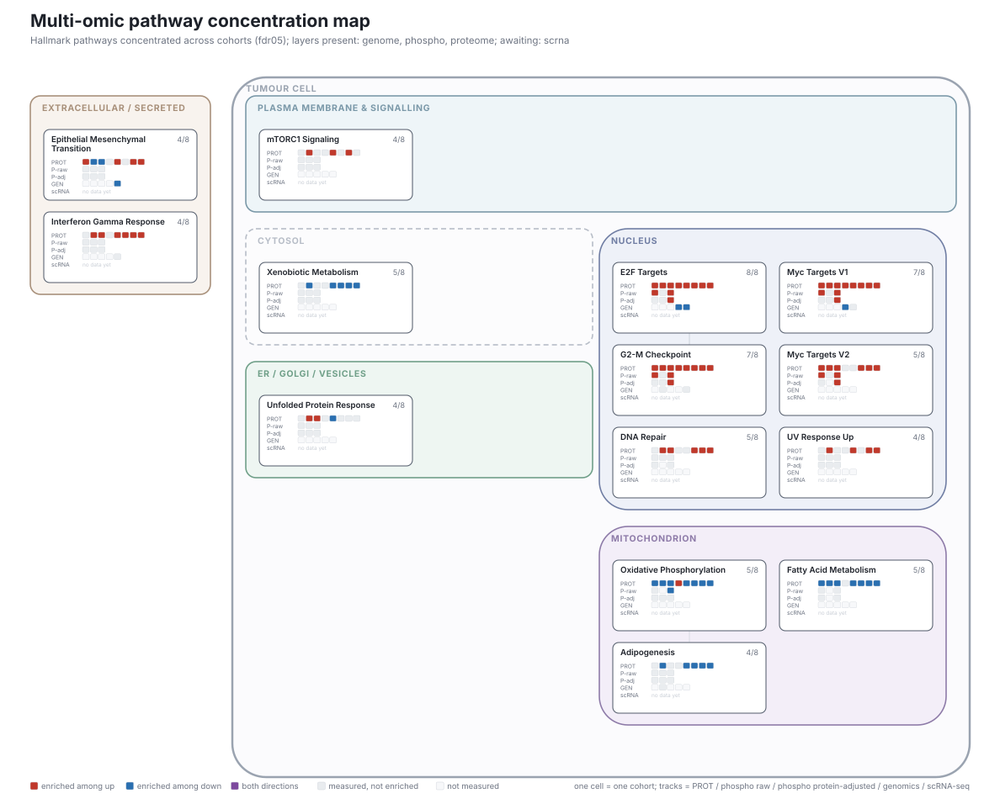

# Multiomics_meta_analysis

Meta-analysis of published proteomics and phosphoproteomics datasets of gastric
and esophageal cancer, and integration with genomics and scRNA-seq data.



## Documentation

Each part has its own README; start with whichever question you have.

| | what it covers |
|---|---|
| **[01_proteomics](01_proteomics/README.md)** | differential analysis per dataset, then the cross-dataset DEP table |
| **[02_phosphoproteomics](02_phosphoproteomics/README.md)** | phosphosites against their own protein, per dataset; shared code in `src/phosphokit` |
| **[03_integration](03_integration/README.md)** | genomics, scRNA-seq and the multi-omics layer |
| **[03_integration/multiomics](03_integration/multiomics/README.md)** | **the joint pathway meta-analysis across all layers -- findings, statistics and figures** |
| [data/README.md](data/README.md) | where every source file comes from and what to name it |
| [docs/methods.md](docs/methods.md) | methods |
| [docs/decisions.md](docs/decisions.md) | decisions and why |

Generated reports, regenerated on every run and readable without cloning:

- [Threshold-scheme comparison](03_integration/multiomics/docs/scheme_comparison.md)
  -- every cutoff run on every cohort, compared on cross-cohort reproducibility
- [Gastric vs oesophageal](03_integration/multiomics/docs/tissue_split.md)
  -- pool the cohorts or split them
- [Master input manifest](03_integration/multiomics/data/master/MANIFEST.md)
  -- provenance, row counts and checksums of the harmonised input

## What the integration found

Details and figures in
**[03_integration/multiomics](03_integration/multiomics/README.md)**.

- **Phospho quantification changes the pathway answer.** Normalising
  phosphosites to their parent protein removes 18-43% of the significant sites,
  and the enriched pathway sets barely overlap (median Jaccard 0.00-0.28 under
  any cutoff). The raw arm's directional signal is largely an echo of protein
  abundance.
- **Gastric and oesophageal cohorts should be analysed apart.** Tumour type
  explains 34% of the variation between the 8 proteome cohorts. The member
  genes show why: one pathway can contain genes moving in opposite directions
  in the two tumour types, so pooling cancels rather than dilutes.
- **Cutoffs are chosen by evidence.** Nine threshold schemes are run on every
  cohort and compared on how reproducibly their pathway calls hold across
  independent cohorts; the winner is used, and the comparison is published.

## Layout

```
01_proteomics/          differential analysis per dataset, then the cross-dataset DEP table
02_phosphoproteomics/   phospho vs protein per dataset (shared code in src/phosphokit), then integration
03_integration/
  genomics/             processing of the collaborator's variant / CNV data
  scrna/                scRNA-seq processing and cell-type signatures
  multiomics/           joint pathway analysis across layers
data/                   inputs (not tracked; see data/README.md for sources)
results/                tables and figures written by the notebooks
docs/                   methods and decisions
```

`01_proteomics` and `02_phosphoproteomics` are independent: the shared package
lives inside `02_phosphoproteomics/src` and is used only by the phospho
notebooks. `03_integration/multiomics` is self-contained and has its own
`requirements.txt`, config and scripts.

## Setup

```bash
conda env create -f environment.yml
conda activate multiomics
```

The phosphoproteomics notebooks call limma through `rpy2`, so R with `limma` and
`statmod` is required; both are in `environment.yml`.

## Running

1. Download the source files into `data/raw/<DATASET>/` following
   [data/README.md](data/README.md).
2. Run the notebook of the dataset from its own folder, e.g.
   `02_phosphoproteomics/per_dataset/PE5.ipynb`. Paths in the notebooks are
   relative to that folder.
3. Results are written to `results/<DATASET>/`.
4. For the joint analysis: `cd 03_integration/multiomics && python scripts/run_all.py`.

## Datasets

| ID | Tissue | Layers | Comparison |
|---|---|---|---|
| PG1-PG4 | gastric | proteome (PG4 also phospho) | tumor vs normal |
| PE1-PE5 | esophageal | proteome (PE2, PE5 also phospho) | tumor vs normal, PE5 by tissue stage |
| GG1, GG2 | gastric | genome (truncating LOF) | tumor vs normal |
| GE1, GE2, GE3 | esophageal | genome (truncating LOF) | tumor vs normal |

## Method summary

- Differential analysis with limma; `duplicateCorrelation(block = patient)`
  whenever a patient contributes to both arms of a comparison.
- Normalization restricted to features detected in most samples, because tumor
  samples detect more low-abundance features and aligning all observed values
  shifts them upward.
- Phosphosites are reported twice: unadjusted, and adjusted for the abundance of
  their protein (per-sample subtraction). The two answer different questions,
  and sites whose protein was not quantified exist only in the unadjusted list.
- Pathway analysis tests every cohort against its own measured background and
  asks how many independent cohorts implicate the same pathway, against a null
  built from each cohort's own flagging rate.

Details are in [docs/methods.md](docs/methods.md) and, for the integration, in
[03_integration/multiomics/README.md](03_integration/multiomics/README.md).

---

## Authorship

Study design, cohort selection, analysis strategy and all interpretation are my
own (Hyunmi Song, POSTECH). The pipeline code was written with Claude
(Anthropic) as a coding assistant, implementing the analyses specified here.
