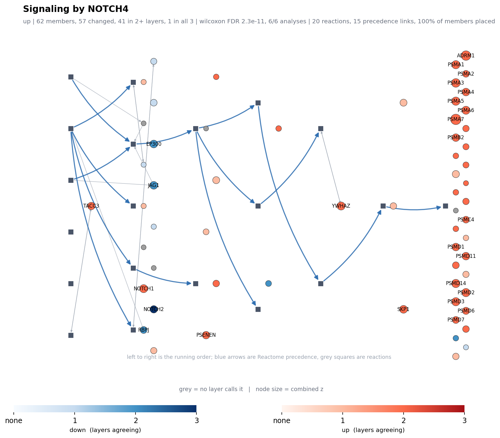

# Multiomics_meta_analysis

Pathway-level meta-analysis of gastro-oesophageal cancer across four omics
layers: **proteome (8 cohorts), phosphoproteome (3 cohorts, 2 normalisations
each), genome (5 cohorts) and scRNA-seq (7 studies)**.

The question is not "which gene causes this". The cohorts are different
patients, different platforms and different labs, so nothing here is causal.
The question is **where independent evidence concentrates**: how many cohorts,
in how many layers, move the same pathway in the same direction. Every cohort is
tested against its own measured universe - never a shared background - because
a proteome that quantifies 7,000 proteins and one that quantifies 3,000 cannot
share a denominator.


## Documentation

| | what it covers |
|---|---|
| **[01_proteomics](01_proteomics/README.md)** | per-dataset limma, the cross-dataset DEP table, proteome-only pathway analysis |
| **[02_phosphoproteomics](02_phosphoproteomics/README.md)** | phosphosites against their own protein; does normalisation change the answer |
| **[03_integration](03_integration/README.md)** | genome and scRNA-seq processing |
| **[03_integration/multiomics](03_integration/multiomics/README.md)** | **the joint analysis: statistics, findings and every figure** |
| [data/README.md](data/README.md) | where every source file comes from |
| [docs/methods.md](docs/methods.md) / [docs/decisions.md](docs/decisions.md) | methods; decisions and why |

Reports regenerated on every run, readable without cloning:
[threshold schemes](03_integration/multiomics/docs/scheme_comparison.md) |
[gastric vs oesophageal](03_integration/multiomics/docs/tissue_split.md) |
[proteome](03_integration/multiomics/docs/layer_proteome.md) |
[phospho](03_integration/multiomics/docs/layer_phospho.md) |
[genome](03_integration/multiomics/docs/layer_genome.md) |
[scRNA](03_integration/multiomics/docs/layer_scrna.md) |
[master input manifest](03_integration/multiomics/data/master/MANIFEST.md)

## How the analysis got to where it is

The design was not "run enrichment on everything". It is three steps, and each
one was forced by the step before.

**1. Genes first - and genes failed.** Merging the eight proteome DEP lists
gives 5,601 genes called somewhere, but **one gene is called in seven cohorts
(EPCAM) and none in all eight**; 3,488 are called exactly once. A one-gene
consensus is not a result. The informative part was *why* it collapsed:
coverage. Cohorts quantify different proteins, so a gene missing from one
cohort can never reach 8 of 8 whatever the biology does.

**2. So, pathways - but not pathway overlap counting.** Pathways absorb
coverage differences, because a pathway can be hit through whichever of its
members a cohort happened to measure. What they do not do is tell you how
surprising an overlap is: comparing pathway lists by Jaccard rewards cohorts
that simply call a lot. Each cohort therefore gets its own flagging rate, and
the null for "k of n cohorts hit this pathway" is a **Poisson-binomial tail**
with those rates, combined across cohorts by **Stouffer with equal weight -
one vote per cohort, never per analysis arm**.

**3. Then back down to the genes.** A pathway-level FDR does not say what
changed. For every pathway that survives, the member genes are counted back out
per layer: how many genome cohorts, how many scRNA cohorts, how many proteome
cohorts moved gene x, and in which direction. That is what makes a call
interpretable - and it is where pooling gastric with oesophageal was caught
cancelling genes that move in opposite directions in the two tumour types.

Cutoffs are not argued about either. **Nine threshold schemes** (4 continuous,
5 genome) are run on every cohort and compared on how reproducibly their calls
hold across *independent* cohorts (mean pairwise Jaccard); the winner is used
and the whole comparison is published.

## Layer by layer

### Proteome - 8 cohorts, tumour vs normal

limma with `duplicateCorrelation(block = patient)` wherever a patient appears in
both arms. Two merge strategies were compared: taking each paper's own DEP list
as published, versus recomputing at FDR 0.05 from the full tables. Genes called
per cohort range from 763 (PG1) to 6,961 (PG4) - a 9-fold spread, which is
exactly why a shared universe would be wrong. Concentration under `fdr05`:
**200 up and 114 down pathways**.

The tissue question was settled here, on proteome evidence alone: tumour type
explains **34% of the between-cohort variation** (ANOSIM / PERMANOVA on
enrichment profiles), and the member genes show pooling cancels rather than
dilutes. Gastric and oesophageal are analysed apart. The confound is stated
plainly: tumour type is not separable from study here, since no cohort contains
both.

### Phosphoproteome - 3 cohorts, two arms each

Each cohort is run twice: raw sites, and sites adjusted for their own protein
(per-sample log2 subtraction). The result is the subproject's point.
**Normalising to the parent protein removes 18-43% of the significant sites**
(PE5: 717 -> 294 genes), and the surviving pathway sets barely overlap the raw
ones (median Jaccard 0.00-0.28 under any cutoff). The raw arm's directional
signal is largely an echo of protein abundance; what is left after adjustment -
13 concentrated pathways, against 10 raw - is small. Only 3 of the 8 proteome
cohorts carry phospho at all, so this is a methodological result, not a
biological consensus.

### Genome - 5 cohorts, truncating LOF only

Received as finished master tables, so only interpretable terms are used:
truncating loss-of-function, no CNV (requested from the collaborator, not yet
available). Five MutSig2CV-based schemes were compared and `g_top200_n2` chosen;
it concentrates **27 pathways, all down**, which is structural - a truncating
variant is loss of function, so this layer can only ever support "down" and can
never contribute to an "up" call. Under the selected scheme 4 of the 5 cohorts
contribute genes; GG2 (n = 25) calls none.

### scRNA-seq - 7 studies

DEGs are computed per lineage in these papers, not per sample, so the studies
were harmonised into one **lineage-level tumour-vs-normal long table**, with
which lineages backed each call kept in a `lineage_support` column. One study
was dropped for reaching no FDR at all (its minimum padj is 0.168). Tumour type
is *not* split here - 6 gastric to 1 oesophageal plus 1 pooled study leaves
nothing to compare - so the whole layer is used together: **116 up and 25 down**
concentrated pathways.

## The integration

Per gene, per layer: the number of cohorts calling it and the direction. Each
layer's count is turned into a surprisal against that layer's own rate, and the
layers are combined by Stouffer into one gene-level z - again one vote per
cohort. Pathways are then judged by **3 methods (Wilcoxon, ORA, permutation) x
2 universes (genes measured in 2+ or in all 3 layers) = 6 analyses**, and only
pathways that survive all six are reported.

**429 pathways pass all six** (362 up, 67 down). RNA processing and transport go
up across layers; the metabolic programme - adipogenesis, bile acid and fatty
acid metabolism, cholesterol homeostasis, oestrogen response - goes down, which
the proteome found on its own and the genome and scRNA layers then support.



**Scoring uses all three gene-set collections (KEGG, Reactome, Hallmark); only
Reactome is drawn.** A figure is only worth drawing if it shows the biochemical
order, and Reactome is the only one of the three that states what happens before
what: each reaction lists its participants and the reactions that must precede
it. So left to right is the running order, grey squares are reactions, blue
arrows are precedence. Colour is a two-ended six-step gradient - red for up,
blue for down, deepening with the number of layers that agree, grey for measured
but unchanged - and node size is the combined z. 277 Reactome sets are figure
candidates, 30 are drawn, and 77 are skipped for having no reaction chain at all
(an assembly step such as Complex I Biogenesis is one reaction with 68 members,
so there is no order to show).

## What this cannot say

- **Not causal.** Different cohorts, different patients. Concentration of
  evidence is the claim; mechanism is not.
- **The pathway tests are competitive** - they ask whether members rank above
  non-members. Genes in a pathway are correlated, so these p-values are
  optimistic; a self-contained statistic is reported beside them.
- **Cohorts are counted, never arms.** Phospho normalisations, genome schemes
  and scRNA lineages are arms of one cohort and must not vote twice.
- **The genome layer is LOF-only**, so "up" can never reach three layers, and
  the layer needs CNV and a deeper variant level to say more.

## Layout

```
01_proteomics/          per-dataset limma, then the cross-dataset DEP table
02_phosphoproteomics/   phospho vs protein per dataset (shared code in src/phosphokit)
03_integration/
  genomics/             the collaborator's variant tables, as received
  scrna/                scRNA-seq processing (private: carries raw accessions)
  multiomics/           the joint analysis: config, src/pmap, scripts 00..14
data/                   inputs (not tracked; see data/README.md)
docs/                   methods and decisions
```

`03_integration/multiomics` is self-contained, with its own `requirements.txt`,
config and scripts.

## Setup and running

```bash
conda env create -f environment.yml
conda activate multiomics
```

The phospho notebooks call limma through `rpy2`, so R with `limma` and `statmod`
is required; both are in `environment.yml`.

1. Download the source files into `data/raw/<DATASET>/` following
   [data/README.md](data/README.md).
2. Run a dataset's notebook from its own folder, e.g.
   `02_phosphoproteomics/per_dataset/PE5.ipynb`; paths are relative to it.
3. Joint analysis: `cd 03_integration/multiomics && python scripts/run_all.py`.

## Datasets

| ID | Tissue | Layers | Comparison |
|---|---|---|---|
| PG1-PG4 | gastric | proteome (PG4 also phospho) | tumour vs normal |
| PE1-PE5 | oesophageal | proteome (PE2, PE5 also phospho) | tumour vs normal, PE5 by tissue stage |
| GG1-GG2 | gastric | genome (truncating LOF) | tumour vs normal |
| GE1-GE3 | oesophageal | genome (truncating LOF) | tumour vs normal |
| SG1-SG5 | gastric | scRNA-seq (lineage level) | tumour vs normal |
| SE1 | oesophageal | scRNA-seq (lineage level) | tumour vs normal |
| SM1 | mixed | scRNA-seq (GC and ESCC pooled by the authors) | tumour vs normal |

Genome and scRNA cohorts are referred to by code; the code-to-accession table
and the raw-source registry are kept outside the repository, so no unpublished
cohort is identified here.

---

## Authorship

Study design, cohort selection, analysis strategy and all interpretation are my
own (Hyunmi Song, POSTECH). The pipeline code was written with Claude
(Anthropic) as a coding assistant, implementing the analyses specified here.
